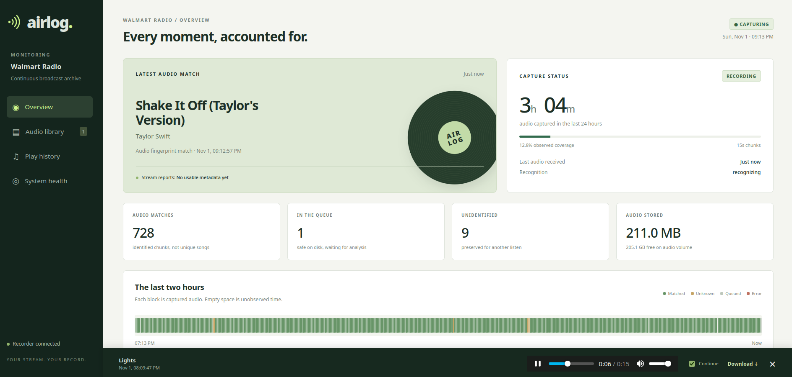

# Airlog — Internet Radio Song History



A self-hosted Docker application for an Unraid server: continuous capture, a durable recognition queue, free song identification, and a web dashboard for progress, history, and preserved audio. No paid API, API key, or hosted frontend is required.

**Status:** Docker Hub releases are triggered by semantic version tags. Unraid templates track the `latest` image tag so updates can be detected from the Docker page.

## Start on Unraid

Installation uses native Unraid XML templates. Storage paths, the dashboard port, and application variables are editable in **Docker → Add Container**. No Compose installation or configuration file is needed.

There are three templates, matching the existing independent services:

| Template | Container |
|---|---|
| [Recorder](templates/my-airlog-recorder.xml) | `airlog-recorder` |
| [Worker](templates/my-airlog-worker.xml) | `airlog-worker` |
| [Dashboard](templates/my-airlog-web.xml) | `airlog-web` |

After a release image is published to Docker Hub, add the three XML templates to Unraid. Airlog is **not listed in Community Applications yet**, so the templates currently need to be installed manually. Download or clone the project onto Unraid, then run:

```bash
mkdir -p /boot/config/plugins/dockerMan/templates-user
cp templates/my-airlog-*.xml /boot/config/plugins/dockerMan/templates-user/
```

The templates use `willisdocker/airlog:latest`. Publish a release to Docker Hub before adding the containers; the release workflow also publishes a versioned tag. Enter the direct audio-stream URL you want to monitor in all three templates; the app cannot read ordinary web pages or authenticated player pages. Copying templates replaces matching saved template files, so check your customized settings afterward.

In Unraid's **Docker** tab, click **Add Container**, choose `airlog-recorder` from the **Template** dropdown (it may have a `user` prefix), and fill in its fields. Repeat for `airlog-worker` and `airlog-web`.

The two host paths must be identical in all three installation forms:

| Unraid input | Suggested host path | Container path |
|---|---|---|
| Appdata | `/mnt/cache/appdata/airlog` | `/data` |
| Audio storage | `/mnt/user/radio/airlog` | `/audio` |

Replace `cache` with your actual local pool name. Keep SQLite appdata on a **direct local pool path**, not SMB or NFS. Audio can live on an Unraid user share. Reserve enough space on the disks backing that share: reported filesystem free space does not necessarily reflect every Unraid allocation constraint.

Prepare the chosen directories with write access for UID 99 / GID 100, Unraid's usual `nobody:users`. For the suggested paths:

```bash
mkdir -p /mnt/cache/appdata/airlog /mnt/user/radio/airlog
chown 99:100 /mnt/cache/appdata/airlog /mnt/user/radio/airlog
```

The templates set `--user=99:100` in **Extra Parameters**. If you use different ownership, change that option in Advanced View on all three forms. The application does not recursively change ownership of your shares.

The dashboard's **Dashboard port** field defaults to **8787**. Open **`http://YOUR-UNRAID-IP:8787`**, or use the container's **WebUI** menu entry. Change that port in the dashboard template if it is already taken.

Shared settings are separate values in Unraid's three templates, not synchronized automatically. Keep **Chunk length** and **Free space reserve** consistent across all three containers. Keep recognition and retention settings consistent between worker and dashboard so the displayed policy matches the worker's behavior. Field descriptions identify the settings' roles; less frequently changed fields are under **Show more settings**.

Enable **Autostart** for all three containers in the Docker tab. The templates also retain the restart policy, health checks, log rotation, read-only root filesystem, and writable temporary storage from the original setup. Docker health checks report problems; Docker itself does **not** restart a container just because it is unhealthy. The recorder and worker implement their own retries.

## What the dashboard does

- **Overview:** recorder status, latest audio match, separately labeled stream metadata, capture coverage over the last 24 hours, recognition backlog, storage, and a two-hour timeline.
- **Audio library:** filter/search recordings, play or download WAV audio, automatically continue through adjacent available chunks, inspect recognition evidence, keep/release audio, and retry recognition.
- **Play history:** consecutive audio matches grouped into observed runs, plus a separate view of stream metadata changes. An unknown interval splits a run; these are not guaranteed full-song play counts.
- **System health:** heartbeats, disk reserve warnings, queue lag, capture interruptions, retention events, and effective configuration.
- **CSV export:** all chunk observations, including timestamps, artist/title, review state, and deletion timestamp. Artist/title strings are escaped against spreadsheet formula interpretation.

The overview polls every five seconds. Library results refresh when opened or when you press Refresh. Times display in the browser's timezone; storage timestamps are UTC epoch seconds. Recordings are genuine captured chunks, not demo data.

## Preservation and accuracy

Automatic matched-audio cleanup is **enabled by default after one hour**. Song recognition cannot tell whether a DJ or advert is talking over the music, so the cleanup heuristic can delete speech mixed into a matched recording. Turn automatic cleanup off if you want to keep all recordings unless you release them manually. No speech-over-music classifier or numeric confidence score is included.

There are three review decisions:

| Decision | Behavior |
|---|---|
| Automatic (initial state) | Eligible matched audio can be deleted after one hour if the five-chunk cleanup heuristic passes. Unknown, pending, failed, recovered, and boundary audio is retained. |
| Keep | Protect this chunk and nearby automatic-cleanup candidates. |
| Release | Permit deletion once its capture time is older than the configured grace period. This is an explicit human decision, including for unknown audio. |

`MATCHED_RETENTION_HOURS=1` is the default grace period. It applies to automatic cleanup and recordings manually released. A release on an older recording permits cleanup on the next worker cycle. Track history and recognition evidence remain after audio deletion. The player stops at missing chunks or connection boundaries.

To turn automatic cleanup off:

Set **Automatically delete matched music** to `false` in both the worker and dashboard Unraid Edit forms, then click **Apply** on each. When enabled, cleanup requires:

1. The target plus two neighbors on each side all have the same Shazam track ID.
2. All five chunks are full-length, contiguous, from one connection session, and not crash-recovered.
3. Recognition offsets advance with the audio timeline within four seconds.
4. None is manually kept; the target is older than the grace period.

This preserves at least two chunks at each detected boundary. Missing offsets, unknowns, pending work, and recognition failures block this heuristic. **It can still delete speech over recognized music**, or delete an interval based on a false match. Keep automatic cleanup off if preserving every captured announcement is more important than storage efficiency. The heuristic does not use stream metadata as deletion evidence.

Audio is normalized to **16 kHz, mono, 16-bit PCM WAV**, approximately **2.76 GB/day** before deletions (about 83 GB per 30 days). This is listenable analysis audio, not an original-quality stereo archive. Unknown audio has no expiry; disk capacity is finite. The recorder pauses at the disk reserve instead of deleting protected audio and retries automatically. A recording already in progress is finalized where space allows. An actual full disk or host power failure can lose the current tail; no system can recover a missed live stream without an upstream archive.

## Architecture

```text
Direct audio stream ──> recorder / FFmpeg ──> WAV + durable manifests on the Audio storage mount
                                         │
                                         v
                                  durable import queue
                                         │
                                         v
                               worker / ShazamIO ──> SQLite
                                         │              │
                              retention decisions       v
                                                    web / dashboard
Optional stream metadata ──> independent polling thread ────────┘
```

### Recorder

An independent process decodes the stream with FFmpeg. It continuously writes PCM, finalizes 15-second WAV chunks, and publishes manifests with atomic renames and fsync. SQLite is not in the capture path. Interrupted PCM files are recovered on restart; even an incomplete final chunk is preserved. A file lock prevents two recorder containers from writing to one audio directory.

FFmpeg connection failures and 30-second stalls trigger capped, jittered reconnects. Each new connection gets a separate session. First decoded audio anchors capture time, and sample counts determine subsequent chunk timestamps; these are approximate receive times, not station transmission timestamps. Buffering and clock changes can affect wall-clock alignment. Connection events record the previous observed end and new start so gaps are visible. The timeline never fills a reconnect gap with an invented song.

### Worker

Durable queue files are acknowledged only after a SQLite commit. Sidecars are rescanned on startup to recover unindexed files. Recognition runs in a separate subprocess with a hard 45-second timeout. Error backoff is global as well as per-chunk, capped at 30 minutes globally and an hour per chunk. One unsuccessful match is retried before being labeled unknown; transport/client failures stay retryable. Retries do not create duplicate chunks or overwrite raw observations.

New chunks get priority over previously attempted chunks; under sustained load, retries can lag. The dashboard exposes the backlog. Recognition attempts start at least `RECOGNITION_INTERVAL_SECONDS` apart, with no parallel requests. Every chunk is eventually eligible for analysis, rather than sampling one spot per song and assuming the rest is safe. This generates up to about 5,760 first attempts/day with 15-second chunks, plus retries. Actual throughput depends on response time. Longer request intervals reduce traffic but can create a permanent backlog if processing falls behind capture.

ShazamIO is a **free, unofficial, reverse-engineered client**, not a guaranteed service. It computes fingerprints and contacts Shazam. It can be throttled or break when the service changes. Audio remains local except for processing/fingerprint exchange performed by that library. Set `RECOGNITION_PROVIDER=none` to disable it while continuing capture and metadata logging. There is no paid fallback.

Metadata polling is independent of recognition. Provide the stream’s metadata endpoint when it offers one; the accepted JSON or `Artist - Title` response depends on the station. Recognized JSON shapes and `Artist - Title` labels are parsed; other payloads remain stored as raw observations and the dashboard reports `unparsed`. Errors are visible, not treated as silence or proof of a song ending. There is no ICY metadata fallback in this version.

### Retention and database

SQLite uses WAL mode, transactional ingestion, idempotent IDs, and a busy timeout. Retention decisions are serialized with user review updates. A durable deletion intent is written before removing audio; restart recovery completes interrupted deletions. Deleted audio has a timestamp and audit event while song observations remain queryable.

This is one-host resilience, not high availability. Server downtime means missed audio. No precise acoustic song-boundary detection, speech/music separation, artist canonicalization, or automatic alert notifications are claimed. The dashboard and Docker health checks expose problems locally.

## Configuration

Edit settings directly in each container's Unraid **Edit** form, then click **Apply** to recreate that container with the new values. The XML templates are the installation source of truth. Unraid saves your selections in its user templates.

| Unraid field | Default | Purpose |
|---|---|---|
| Appdata | `/mnt/cache/appdata/airlog` | SQLite, heartbeats, backups, worker lock; same host path in all containers |
| Audio storage | `/mnt/user/radio/airlog` | Captures, finalized audio, sidecars, queue; same host path in all containers |
| Dashboard port | `8787` | Host port mapped to container port 8080; dashboard only |
| Stream Name | `Internet Radio` | Optional dashboard label set in the web template |
| Extra Parameters: `--user` | `99:100` | Container user/group; Advanced View |
| Stream URL | Required; no default | Direct FFmpeg-compatible audio stream URL; set the same URL across containers |
| Metadata URL | Blank | Optional station metadata endpoint; blank disables metadata polling |
| Chunk length (seconds) | `15` | Allowed 10–30 seconds; match across containers |
| Free space reserve (GB) | `5` | Decimal GB reserved on audio filesystem |
| Recognition provider | `shazam` | `shazam` or `none` |
| Recognition interval (seconds) | `10` | Minimum interval between attempt starts |
| Metadata interval (seconds) | `15` | Poll interval, minimum 5 seconds |
| Retention grace period (hours) | `1` | Grace period before permitted deletions |
| Automatically delete matched music | `true` | Enables the five-chunk heuristic described above; set `false` in worker and dashboard to disable |
| Dashboard username / password | `admin` / blank | Optional HTTP Basic authentication; password field is masked |

Internally these variable fields are passed as Docker environment variables (for example, `STREAM_URL`, `STREAM_NAME`, and `AUTO_DELETE_MATCHED`). You configure them in Unraid's input fields, not a separate file. `STREAM_NAME` only affects the dashboard label and page title; it does not change stream capture or recognition.

Keep the dashboard on your trusted LAN. If exposing it through a reverse proxy, use HTTPS and set **Dashboard password** or enforce authentication at that proxy. The UI can play all recordings and authorize deletion after the grace period. No CORS access is enabled. Secrets are not returned by the status API.

## Operations

Use Unraid's Docker tab to view logs, stop/start containers, or edit variables and click **Apply**. Terminal equivalents for inspection and backup:

```bash
docker ps --filter name=airlog-
docker logs --tail=100 -f airlog-recorder
docker logs --tail=100 -f airlog-worker
docker logs --tail=100 -f airlog-web

# Consistent online database backup
docker exec airlog-web python scripts/backup.py
```

To upgrade, change each container's **Repository** field to the new image version and click **Apply**. This pulls that version from Docker Hub.

Backups land in the `backups` subdirectory of your chosen Appdata host path. Schedule that command with Unraid User Scripts if desired, and copy backups plus preserved audio to a different device. Backups do not expire automatically. Do not copy only the live SQLite main file without accounting for its WAL; use the backup command or stop the services first.

To restore: stop all services, preserve the existing appdata directory, restore the backup as `radio.sqlite3` into a clean appdata directory, restore the audio directory, set ownership, and start again. Avoid mixing a restored database with old `-wal`/`-shm` files. Sidecars can recreate basic capture inventory if the database is lost, but **not** recognition history or Keep/Release decisions. A restored backup predating a deletion may list missing audio; restore audio from the same point or inspect the mismatch before enabling cleanup.

Never run two workers against the same appdata volume. Singleton file locks enforce this for accidental duplicates. Do not share these directories across separate servers.

## Development and verification

### Publishing a release

The GitHub Actions workflow at `.github/workflows/publish-image.yml` builds one `linux/amd64` image and pushes it under both its semantic version and the `latest` tag. It does not publish on ordinary commits; pushing a version tag is the explicit release decision. The Unraid templates use `latest` so Unraid can detect new releases, while version tags remain available for users who prefer to pin a release.

In GitHub, open **Settings → Secrets and variables → Actions** and add a repository secret named `DOCKERHUB_TOKEN`. Create a Docker Hub personal access token with read/write access to `willisdocker/airlog`; do not put the token in the repository or workflow. The workflow uses the Docker Hub account `willisdocker`.

Commit and push the release source. Then tag and push the release. For example:

```bash
VERSION=0.1.3
git push origin main
git tag -a "v$VERSION" -m "Airlog $VERSION"
git push origin "v$VERSION"
```

GitHub Actions validates the `vMAJOR.MINOR.PATCH` tag and publishes `willisdocker/airlog:MAJOR.MINOR.PATCH` and `willisdocker/airlog:latest` from the same build. Each release needs a new semantic version. The workflow does not create or submit a Community Applications listing; that is a separate step.

The Docker build context excludes `templates/`, `icons/`, tests, and the README. Those files remain in GitHub for Unraid users and the template catalog; they are not copied into the image.

Core capture, storage, HTTP, and tests use Python's standard library plus FFmpeg. ShazamIO is the only direct Python dependency, pinned in `requirements.txt`; its transitive dependencies are resolved during the image build.

```bash
python3 -m unittest discover -s tests -v
node --check static/app.js
node tests/frontend.test.cjs
```

Tests include real FFmpeg decoding of a generated WAV, partial-chunk recovery, import recovery across database failure, retry state transitions, conservative retention boundaries, deletion-intent recovery, history grouping, HTTP byte ranges, authentication, request validation, and CSV escaping. HTTP tests exercise the actual request handler over in-memory transports because this workspace forbids sockets. Four frontend behavior tests execute the dashboard with a DOM stand-in, covering rendering, escaping, navigation, and review actions. They do not replace a network or browser integration test.

For a local development run, install requirements in a virtual environment and launch these in separate terminals. Set `STREAM_URL` to the same direct audio-stream URL for all three processes:

```bash
STREAM_URL='https://your-host.example/path/to/audio-stream' DATA_DIR="$PWD/.local/data" AUDIO_DIR="$PWD/.local/audio" python -m radio recorder
STREAM_URL='https://your-host.example/path/to/audio-stream' DATA_DIR="$PWD/.local/data" AUDIO_DIR="$PWD/.local/audio" python -m radio worker
STREAM_URL='https://your-host.example/path/to/audio-stream' DATA_DIR="$PWD/.local/data" AUDIO_DIR="$PWD/.local/audio" python -m radio web
```

Local web port is 8080. On Unraid, validate a 24-hour run before enabling automatic cleanup: listen to matched transitions and unknowns, check the recognition backlog, restart the containers, and confirm capture resumes and existing recordings remain playable.

Audio fingerprints are sent to Shazam through ShazamIO for recognition; verify its current service terms and behavior before relying on it.

The XML layout follows [Unraid’s official Community Apps template starter](https://github.com/unraid/unraid-community-apps-starter/blob/main/templates/example-app.xml). Airlog has not yet been submitted to the Community Apps catalog.
